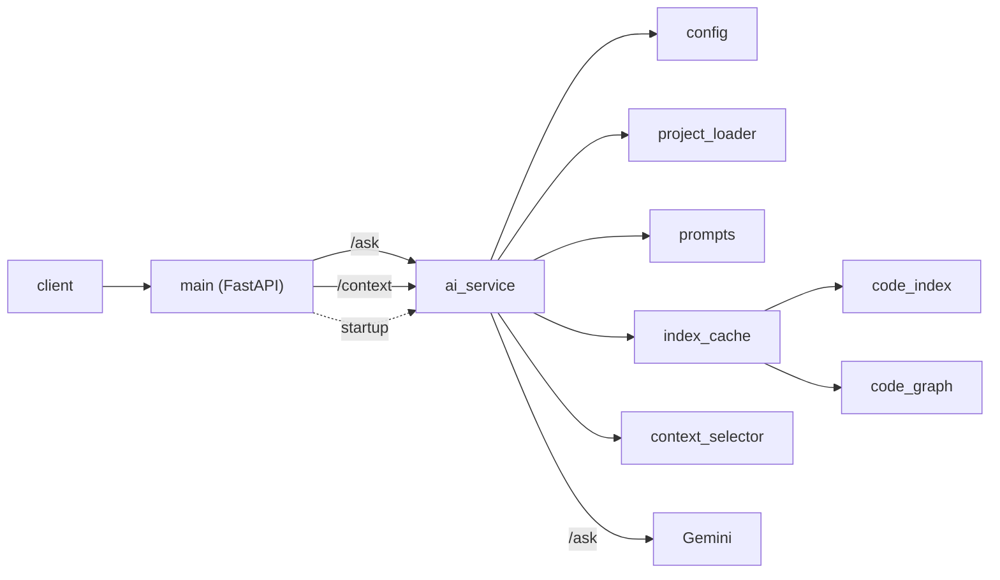

# Embedded AI Copilot

This is an AI assistant for understanding embedded C/C++ codebases. You send a question to a small FastAPI app. The app reads one project directory, `sample_project/` by default, configurable via `PROJECT_PATH`. It puts those source files into one prompt, and asks Gemini for an answer.

## Status

Phase 4 complete. Phase 5 (semantic retrieval) in progress.

## Request path



## Modules

- `app/main.py` is the HTTP layer. It serves `GET /`, `POST /ask`, and `POST /context`, checks the question, and maps service errors to the same status codes for both POST endpoints. A lifespan thread warms the index at startup. It does not read the project or call Gemini.
- `app/ai_service.py` prepares one prompt on a path shared by `generate_answer` and `dry_run`: load files, get the index and graph from the cache, then route. Projects that fit use the full project map and count tokens (retrying once without the map if the map pushed the prompt over budget). Projects that do not fit use partial mode: a focused map, whole files selected for the question, and a partial-context notice. `generate_answer` sends that prompt to Gemini and, in partial mode, adds a footer to the answer. `dry_run` returns the same prompt and does not call Gemini. It estimates tokens from the character length unless `exact` is set, in which case it uses the same token count as `/ask`. It raises `ProjectLoadError`, `ProjectTooLargeError` (413, only when no selected file fits), `UpstreamRejectedError`, `EmptyUpstreamResponseError` (subclass of `UpstreamRejectedError`, maps to 502), `UpstreamUnavailableError`, or `RateLimitedError` (429). It does not define routes or scan the disk itself.
- `app/gemini_retry.py` retries Gemini calls on rate limits and transient errors with backoff and a per-request budget. It does not build prompts or know about HTTP.
- `app/context_selector.py` ranks files for a question from names in it and the index/graph, and packs whole files into a char budget. `rank_files_detailed` returns the same order as `rank_files`, plus a reason. `fuse_rankings` fuses that order with a semantic file order by reciprocal rank (k=60). It does not read the disk or call Gemini.
- `app/index_cache.py` keeps the last project's index and graph in memory. A file is re-parsed only when its path or content (SHA-256) changes, and the graph is updated incrementally for content edits and for added, removed or renamed files (up to max(200, 2%) changed files and 5,000 includes to re-resolve), and rebuilt otherwise. It does not read the disk or call Gemini.
- `app/project_loader.py` reads the filesystem and applies the selection rules (extensions, hidden and build directories, directory-name excludes, and the size cap). It returns files sorted, with paths relative to the project root. It does not build prompts or call Gemini.
- `app/prompts.py` builds the prompt from `app/prompts/assistant.md`, the file text, and the question. Full mode adds a project map (capped at 20% of the budget, compacted in fixed tiers) before the files and a file/line count header. Partial mode adds a focused map and a partial-context notice, then the selected files in rank order. It does not load the tree or call Gemini.
- `app/config.py` loads `.env` and checks `GEMINI_API_KEY`, `GEMINI_MODEL`, `EXCLUDE_DIRS`, `MAX_PROMPT_TOKENS`, `SEMANTIC_SEARCH`, `EMBEDDING_MODEL`, `EMBEDDING_CACHE_DIR`, and that the project directory exists and is a directory. It returns a frozen `Settings` dataclass. It does not call Gemini.
- `app/models.py` holds the `ProjectFile` dataclass, the index dataclasses (`SymbolKind`, `Symbol`, `Include`, `Call`, `FileSymbols`, `ProjectIndex`, `SymbolRef`, `CallRef`, `ResolvedInclude`, `ProjectMap`), `Chunk`, `RankedFile`, `PreparedPrompt`, and `Answer` / `AnswerContext`. The HTTP body is `AskRequest` in `main.py`.
- `app/code_index.py` parses each loaded C/C++ file with tree-sitter and records its functions, prototypes, macros, types, file-scope variables and includes with line numbers and the names each function calls (C++: classes, namespaces, qualified names). Headers use the C++ grammar. Parse errors are tolerated. It is used by `/ask` for the project map. It does not read the disk or call Gemini.
- `app/chunker.py` builds retrieval chunks (file cards and function chunks) from the tree-sitter index; doesn't embed, store or rank.
- `app/embedder.py` turns text into normalized vectors with a local fastembed model, loaded lazily on first use; doesn't chunk, store or rank.
- `app/semantic_search.py` ranks files by embedding similarity over in-memory chunk vectors; doesn't persist or call Gemini.
- `app/code_graph.py` builds name-based relations from the index (who calls what, #include resolution with the nearest match first, .c/.h pairs). Ambiguous matches are kept as several candidates. `update_graph` patches a graph for content edits and path changes; the result equals a full rebuild. Used by /ask for the project map. It does not read the disk or call Gemini.
- `app/logging_config.py` sets up logging (console INFO, file DEBUG for the app's own loggers). It does not choose the log messages.

## Setup

Python 3.14 (>=3.14,<3.15). From the repo root:

```bash
uv python install 3.14
uv python pin 3.14
uv sync
```

Pin CPython 3.14. A newer interpreter can fail to build the locked `pydantic-core`.

Create `.env` in the repo root, or export the same variables:

```
GEMINI_API_KEY=your-key
GEMINI_MODEL=your-model
# Optional: directory to analyze (default: sample_project/)
# PROJECT_PATH=/absolute/path/to/your/embedded/repo
# Optional: comma-separated directory-name patterns to skip; replaces the vendor defaults.
# Use "," to include all vendor code. Hidden and build dirs are always skipped.
# EXCLUDE_DIRS=CMSIS,*_HAL_Driver,Middlewares,third_party,vendor,external,GenData
# Optional: max prompt size in tokens (default 200000; Gemini 3.1 Pro input pricing doubles above 200k).
# MAX_PROMPT_TOKENS=200000
# Optional: semantic ranking for partial context. Default is local. `off` disables it.
# SEMANTIC_SEARCH=local
# Optional: local embedding model (default BAAI/bge-small-en-v1.5).
# EMBEDDING_MODEL=BAAI/bge-small-en-v1.5
# Optional: models and vectors; default .cache/ in the repo.
# EMBEDDING_CACHE_DIR=.cache
```

Startup fails if either value is missing or empty (`RuntimeError: GEMINI_API_KEY is not set.` or `RuntimeError: GEMINI_MODEL is not set.`).

The running app reads one project directory. `PROJECT_PATH` unset, empty, or whitespace-only uses `sample_project/`. A relative path resolves against the repo root, not the process cwd. A leading `~` is expanded. An absolute path is recommended. The path must be an existing directory or startup fails. The path is read once at startup; restart the app after changing it. One project is used per process. It loads `.c`, `.h`, `.cpp`, `.hpp`, `.cc`, `.cxx`, `.hh`, `.hxx`, `.inl`, `.s`, `.asm`, and `.ld` files, including files in subdirectories. Suffixes are matched case-insensitively, so `.S` and `.s` assembly and `.ld` linker scripts load.

What gets loaded: hidden directories and `build`, `out`, and `cmake-build-*` are always skipped. The vendor defaults are skipped by name, at any depth, case-insensitive. Files over 512 KiB, and files that are neither UTF-8 nor cp1252, are skipped; a file that isn't valid UTF-8 is read as Windows-1252 (cp1252). Each load logs **one summary line per kind** (cp1252 at INFO, the two skip kinds at WARNING) with the count and up to 3 example paths relative to the project. The per-file list is written at DEBUG level to logs/app.log only (console stays at INFO).

Prompt order in full mode: instructions, project map, file/line count header, files sorted by path (relative paths, per-file line counts), question. The map lists per file its includes, types, macros, variables, declared and defined functions (with line ranges) and statics. It's capped at 20% of MAX_PROMPT_TOKENS (about 3 characters per token) and compacted in fixed tiers (no macros, then no statics, then counts only, then omitted). Its first line names the tier. Headers included but not loaded are listed as external. Partial mode uses the same instructions, then a focused map, a partial-context notice, the selected files in rank order, and the question.

## Prompt budget

Each answer calls Gemini's free `count_tokens` before `generate_content`. Routing uses the total source characters. At most 10 characters per allowed token, the request stays in full mode: the project map, every file, and one count. If that count is over the limit, the map is dropped and the tokens are counted again. If both full counts are over, or the source is already over the character limit, the request uses partial context instead of returning 413. The character limit does not skip the index: the cache is read on every request, and a background thread warms it at startup.

Partial context ranks files from names in the question and the index and graph. When semantic search is enabled and its index is ready, that order is fused with the semantic ranking; until then the ranking stays lexical. Whole files are then packed into the remaining character budget. See Semantic search. The prompt includes a partial-context notice. The answer text ends with a fixed footer stating how many of the project files fit the token budget and that the included files are listed in context.files_included. One exact count follows. If it is still over, the lowest-ranked included files are dropped once and the prompt is counted again. 413 is returned only when not even one selected file fits (an estimated count, with no `count_tokens` call) or when the partial prompt is still over the limit after that shrink. A request counts tokens at most four times. A `MAX_PROMPT_TOKENS` value above about 1M gets a 502 from Gemini. The index and graph stay cached between requests and refresh from the loaded files, so code edits are picked up without a restart.

## Run

From the repo root:

```bash
uv run uvicorn app.main:app --host 127.0.0.1 --port 8000
```

Logs go to `logs/app.log` and to the console, including the startup configuration messages. The console shows INFO and above, and `logs/app.log` also records DEBUG messages from the app's own modules (not from libraries). code_index's existing per-file "Parse errors" DEBUG lines will now also appear in `logs/app.log`. The `logs/` directory is created when the app starts.

## API

`GET /`

```bash
curl http://127.0.0.1:8000/
```

```json
{"message":"Embedded AI Copilot is running"}
```

`POST /ask`

```bash
curl -X POST http://127.0.0.1:8000/ask \
  -H "Content-Type: application/json" \
  -d '{"question":"Where is the answer initialized?"}'
```

Request body: `{"question":"<non-empty string>"}`.

Response body: `{"answer":"<text>","context":{...}}`. `answer` is the model text. In partial mode that text also ends with the partial-context footer.

`context` describes what was sent:

```json
{
  "mode": "partial",
  "files_total": 16595,
  "files_included": [
    "Projects/STM32F4-Discovery/Examples/GPIO/GPIO_EXTI/Src/stm32f4xx_it.c"
  ],
  "prompt_tokens": 48000,
  "map_tier": "focused"
}
```

`mode` is `full` or `partial`. `files_included` lists every loaded file in full mode, and the files that were sent in partial mode. `prompt_tokens` is the exact count of the prompt that was sent. `map_tier` is the project map tier, or `null` when full mode dropped the map.

`POST /context`

Same body as `POST /ask`. It returns what `/ask` would send, and it does not call Gemini.

```bash
curl -X POST http://127.0.0.1:8000/context \
  -H "Content-Type: application/json" \
  -d '{"question":"In STM32F4-Discovery GPIO_EXTI, what does EXTI0_IRQHandler call?"}'
```

On the 38-file selection fixture, with `MAX_PROMPT_TOKENS` at 2000, that question returns:

```json
{
  "mode": "partial",
  "limit": 2000,
  "prompt_tokens": 1454,
  "token_source": "estimate",
  "prompt_chars": 4362,
  "files_total": 38,
  "files_included": [
    "Projects/STM32F4-Discovery/Examples/GPIO/GPIO_EXTI/Src/stm32f4xx_it.c",
    "Projects/STM32F4-Discovery/Examples/GPIO/GPIO_EXTI/Inc/stm32f4xx_it.h",
    "Projects/STM32F4-Discovery/Examples/GPIO/GPIO_EXTI/Inc/main.h",
    "Projects/STM32F4-Discovery/Examples/GPIO/GPIO_EXTI/EWARM/startup_stm32f407xx.s"
  ],
  "map_tier": "focused",
  "map_files": 7,
  "ranked_total": 38,
  "ranked": [
    {
      "path": "Projects/STM32F4-Discovery/Examples/GPIO/GPIO_EXTI/Src/stm32f4xx_it.c",
      "reason": "defines",
      "included": true,
      "focus": 2,
      "tier": 1,
      "hits": 1,
      "lexical": 6
    }
  ]
}
```

`ranked` in that example is only the first of 38. The response lists up to 50, and `ranked_total` is the full count. Full mode returns `ranked_total` 0 and `ranked` `[]`. `included` says whether that ranked file is in the prompt. `files_included` is every loaded file in full mode, and the packed files in partial mode. `map_files` is 0 when full mode drops the map.

`prompt_tokens` defaults to `ceil(len(prompt) / 3)` and `token_source` is `estimate`. That estimate is conservative. Near the limit it can choose partial mode where `/ask` would still fit in full mode. `?exact=true` counts tokens with Gemini's free `count_tokens` (this needs a key) and then matches `/ask`. 502, 503 and 429 are only possible with `?exact=true`.

## Errors

| Status | When | Body |
| --- | --- | --- |
| 200 | Gemini returned text | `{"answer":"<text>","context":{...}}` |
| 422 | Invalid, empty, or whitespace-only `question` | validation `detail` list, example below |
| 413 | Prompt exceeds the token budget, only when even one selected file does not fit | `{"detail":"Project is too large for the prompt budget: <n> tokens, limit <limit>. Point PROJECT_PATH at a smaller directory or raise MAX_PROMPT_TOKENS."}` |
| 500 | Project files could not be loaded | `{"detail":"Project files could not be loaded."}` |
| 500 | Unexpected error | `Internal Server Error` |
| 429 | Gemini rate limit, still hit after retries | `{"detail":"AI provider rate limit reached. Retry after <n> seconds."}` plus a `Retry-After: <n>` header |
| 502 | Gemini rejected the request (4xx other than 429), or returned empty text, or returned no token count | `{"detail":"AI provider rejected the request."}` |
| 503 | Gemini is unavailable (5xx or a network error) after retries | `{"detail":"AI provider is unavailable."}` |

Empty question:

```bash
curl -X POST http://127.0.0.1:8000/ask \
  -H "Content-Type: application/json" \
  -d '{"question":""}'
```

```json
{"detail":[{"type":"string_too_short","loc":["body","question"],"msg":"String should have at least 1 character","input":"","ctx":{"min_length":1}}]}
```

A missing `question` or a non-string `question` also returns 422, with a different `detail` list. An unexpected exception returns the plain text `Internal Server Error`.

`POST /context` uses these same status codes and the same `detail` text. 502, 503 and 429 happen only with `?exact=true`.

## Retries

Gemini calls (`count_tokens` and `generate_content`) retry HTTP 429, 500, 502, 503, and 504, plus connection and timeout errors. Each call gets at most 3 attempts, with exponential backoff and full jitter, unless the server sends a hint (RetryInfo `retryDelay`, otherwise `Retry-After`).
All Gemini calls in one request share a 20-second sleep budget. If the next delay is longer than the time left, the call fails at once, so a long quota hint returns 429 without sleeping.
A request can block for up to 20 seconds of sleeps. The endpoints are `async def` running blocking code, so other requests, including `GET /`, wait too.
Retrying `generate_content` after a 5xx can bill twice if the server actually finished. That is acceptable on the free tier.

## Tests

```bash
uv run pytest
```

The tests run offline. Gemini is mocked.

## Selection eval

`tests/test_selection_eval.py` ranks 14 questions against a 38-file fixture: two boards, three examples, and the BSP. Each case checks that every expected file is inside its own pinned top-k.

A case's rank is the worst (largest) rank among its expected paths, or absent when any expected path is missing. The case passes when that rank is at most k. hit@5 counts cases whose rank is at most 5. MRR is the mean of 1/rank, and a missing rank counts as 0. Each case file ends with `summary: pass P/N, hit@5 H/N, MRR 0.xx`.

Two cases are pinned at k=4, where today's ranking misses a tighter cutoff:

- E7, "Which function handles the ADC interrupt in ADC_RegularConversion on STM32F429I-Discovery?": there is no synonym from "interrupt" to `IRQ`, so the handler is rank 4.
- E10, "Who calls BSP_LED_Toggle?": the definition ranks before the callers, so the call sites are ranks 3 and 4.

`scripts/cube_semantic_dev.json` holds 12 plain-language questions for measuring semantic retrieval. `scripts/cube_semantic_heldout.json` holds 8 plain-language questions. The held-out file is run only at the spec 25 gate and later Phase 5 milestones. Nothing (chunking, fusion, glossary) is tuned on it. If a held-out case is wrong (bad expected path), it is fixed and the fix logged, not dropped.

Baseline: lexical ranking, b0c3c6a: structural 8/8, MRR 0.81; semantic dev hit@5 7/12, MRR 0.45.

`--ranker hybrid` fuses the lexical/graph ranking with max embedding similarity per file by reciprocal rank (k=60). When the question names a board directory, only files under that board take a semantic rank. Vectors stay in memory. Hybrid mode requires at least one `--scope` and refuses before loading the model when the unique chunk count is above `--max-chunks` (default 5000).

The gate is one hybrid run of the structural, dev, and held-out case files. Held-out is run exactly once, in that gate run, and nothing (chunking, fusion, thresholds, or case files) is tuned after seeing it. GO requires every check:

1. `dev_hit5`: dev hybrid hit@5 >= 8/12
2. `dev_mrr`: dev hybrid MRR >= 0.55
3. `heldout_hit5`: held-out hybrid hit@5 >= held-out lexical hit@5 + 1
4. `heldout_mrr`: held-out hybrid MRR >= held-out lexical MRR + 0.05
5. `structural_pass`: structural hybrid passes 8/8
6. `structural_ranks`: every structural hybrid rank <= its lexical rank + 1

```bash
uv run pytest tests/test_selection_eval.py
uv run python scripts/eval_selection.py <cube_root> scripts/cube_eval_cases.json scripts/cube_semantic_dev.json
uv run python scripts/eval_selection.py <cube_root> scripts/cube_semantic_dev.json --json /tmp/eval.json
uv run python scripts/eval_selection.py <STM32CubeF4 clone root> \
  scripts/cube_eval_cases.json scripts/cube_semantic_dev.json scripts/cube_semantic_heldout.json \
  --ranker hybrid --scope Projects/STM32F4-Discovery --scope Projects/STM32F429I-Discovery \
  --gate --json /tmp/gate.json
```

`scripts/eval_selection.py` loads a Cube tree with the default directory excludes, builds the index and graph once, and ranks every given case file. With no case file it uses `scripts/cube_eval_cases.json`. It does not call Gemini. A failing case still exits 0. `--gate` and `--gate-from` exit 0 for both GO and NO-GO.

Gate result (2026-10-20, code sha ca4607b, 4 CPUs): **GO**. Scope `Projects/STM32F4-Discovery` and `Projects/STM32F429I-Discovery`: 739 files, 4061 chunks, 2002 unique, embedded in 214.5 s (9.3 chunks/s), peak RSS 1,150,520 kB. Dev hybrid hit@5 8/12, MRR 0.60 (lexical 7/12, MRR 0.45). Held-out hybrid hit@5 6/8, MRR 0.33 (lexical 2/8, MRR 0.24). Structural hybrid 8/8, every hybrid rank 1. Checks: dev_hit5 8/12, dev_mrr 0.595870, heldout_hit5 hybrid 6 vs lexical 2, heldout_mrr hybrid 0.333117 vs lexical 0.236795, structural_pass 8/8, structural_ranks max hybrid-lexical 0. Held-out was run once, in this gate. Dev is the prototype's 8/12 and 0.60, and structural is 8/8.

### Zephyr

`scripts/fetch_zephyr_core.py` clones the Zephyr RTOS core only, pinned to v4.4.2 (`dccb09599635`), into `zephyr-core/`. It does not include `boards/`, `drivers/`, `dts/`, `soc/`, or `modules/`.

`scripts/zephyr_check_slice.py` copies the manifest's files from `zephyr-core/` to `zephyr-core-check/`. The slice is about 930 unique chunks, and the script refuses more than 1,500.

`scripts/zephyr_eval_cases.json` holds 8 structural questions. `scripts/zephyr_semantic_dev.json` holds 18 questions tagged code, asm, kconfig, doc, conf, and devicetree. `scripts/zephyr_semantic_heldout.json` holds 8 questions tagged code, cmake, doc, and kconfig. `zephyr_semantic_heldout.json` is run once per phase gate, never to tune.

What is indexed: Kconfig, CMake, devicetree (`.overlay`, `.dts`, `.dtsi`), `.conf`, YAML and rst files are loaded and chunked (Kconfig option blocks, rst sections, text pieces of at most 1,500 characters, at most 8 per file). Assembly (`.S`, `.s`, `.asm`) is chunked per function plus a file card (`.ld` linker scripts are not indexed). `uv run python -m scripts.zephyr_stage_gate --stage 31a --baseline ... --current ...` checks dev hit@5 at least 17/18, dev MRR at least baseline + 0.009, no passing case lost, and structural 8/8; held-out v1 is consumed and is not re-run.

Naming links (spec 32). `CONFIG_X` tokens in C/C++, assembly and CMake files are references (graph calls with an empty caller), so a CONFIG question ranks the Kconfig/`.conf` definition first and the users next, ordered by number of references. A question naming `k_foo` also finds `z_impl_k_foo` and `z_vrfy_k_foo`. Generated `z_mrsh_` names and devicetree macros are not linked. `scripts/zephyr_semantic_dev2.json` (10 questions) is a dev set. `scripts/zephyr_semantic_heldout2.json` (8 questions) is one-shot (run once after the dev gate says GO, on the pre-change and the final code). `uv run python -m scripts.zephyr_stage_gate --stage 32 --baseline ... --current ...` checks dev hit@5 at least 17/18, dev MRR at least baseline + 0.03, no passing dev case lost, dev2 hit@5 at least 9/10, dev2 MRR at least baseline + 0.05, no passing dev2 case lost, no dev2 tag worse, structural 8/8, and at most 1,500 unique chunks in scope `.`; with `--heldout` and `--heldout-baseline` it also requires held-out2 hit@5 at least 6 and at least the lexical hit@5 and the pre-change hybrid hit@5.

`app/prompts.py` shows them as "(not parsed)". `scripts/zephyr_gate.py` checks dev hit@5 at least 15/18, dev MRR at least 0.08 above the baseline, no previously passing dev case lost, structural passes equal to the case count, and at most 1,500 unique chunks in scope `.`. The held-out file runs once, only after the dev gate says GO; with `--heldout` it also requires held-out hit@5 at least 6 and at least the lexical hit@5.

```bash
uv run python scripts/fetch_zephyr_core.py
uv run python scripts/zephyr_check_slice.py
export EMBEDDING_CACHE_DIR=/tmp/s30-cache
uv run python scripts/eval_selection.py zephyr-core-check scripts/zephyr_eval_cases.json scripts/zephyr_semantic_dev.json --ranker hybrid --scope . --max-chunks 1500 --json scripts/zephyr_baseline.json
```

```bash
uv run python scripts/chunk_stats.py <project_dir>
```

`scripts/chunk_stats.py` loads a project with the default directory excludes, builds the index, and prints chunk counts, size and cost estimates. It times chunking only. It does not embed.

On STM32CubeF4 (Projects only): 16,595 files, 11,911 parsed, 64,994 chunks, 18,451 unique, 14.07M chars (~3.5M tokens), chunking 1.1 s.

## Embedding check

```bash
uv run python scripts/embed_check.py <STM32CubeF4 clone root> --scope Projects/STM32F4-Discovery
```

Embeds one board folder. `--scope` is required, and the check stays on that folder rather than the whole Cube. The script loads the project with the default directory excludes, builds the index, chunks it, and embeds the unique chunk texts under the scope with the local model.

Each line:

- `files N parsed P` — files loaded from the project, and how many tree-sitter parsed.
- `scope DIR files F chunks C unique U` — files, chunks, and unique texts inside the scope. Several `--scope` values are joined with commas.
- `model NAME cache CACHE/models (present|absent before load)` — model name, cache directory, and whether that directory existed before this run.
- `model load S.S s` — seconds to load the model, including the download on a cold run. Timed around one warm-up query.
- `model files X.X MB` — size of regular files under the model cache, in decimal megabytes. Symlinks are not followed.
- `embed U chunks in S.S s (R.R chunks/s)` — one `embed_documents` call over the unique texts.
- `peak_rss_mb M` — peak resident set size of this process, in megabytes.

On the measurement box (8 vCPU), STM32F4-Discovery was 298 parsed files, 1,673 chunks, 1,043 unique, about 55–80 s (about 13–18 chunks/s), peak RSS about 1.1 GB, and model files about 67 MB. The first run downloads about 67 MB into `.cache/models`. A later run loads that cache in about 0.5 s.

Chunk embeddings are also stored on disk under `<EMBEDDING_CACHE_DIR>/vectors/<model>/`. The directory holds three files (`vectors.npy`, `keys.json`, `meta.json`), keyed by chunk hash, so a restart reuses every stored row and an edit embeds only the chunks whose text changed. Deleting it is safe (`rm -r .cache/vectors`); the next ensure rebuilds it. About 1.5 KB per chunk, about 1.6 MB for STM32F4-Discovery.

```bash
uv run python scripts/vector_check.py <STM32CubeF4 clone root>/Projects/STM32F4-Discovery --scope . --cache-dir /tmp/vec-check
```

`scripts/vector_check.py` embeds one scope into that index and prints ensure, lookup, size, and peak RSS. Partial `/ask` and `/context` read that index once it is ready.

## Semantic search

Semantic search runs only for partial context. When the whole project fits the prompt, nothing is built and the embedding model is not loaded.

`SEMANTIC_SEARCH` defaults to `local`. One background thread (`semantic-build`) builds the vector index at startup when the project is over the character pre-check, and the first partial request starts it otherwise (a project that goes partial only because the counted prompt is over the token limit). Until the index is ready, `/ask` and `/context` keep today's lexical ranking. A failure (model download, an offline machine, a disk error) logs one warning and stays lexical for five minutes, then the next partial request tries again.

`POST /context` then includes a top-level `semantic` field (`off`, `building`, or `ready`) and a `semantic` field on every `ranked` item (the 1-based semantic rank, or null). Both are omitted when semantic search is off, so that response stays key-for-key the same as a lexical run. `/ask` does not change shape.

Costs of the default `local` mode:

- The first run downloads about 67 MB into `<EMBEDDING_CACHE_DIR>/models`.
- Building the STM32F4-Discovery folder peaks at about 1.1 GB of RAM and takes about one to two minutes. Requests are not blocked while that runs; answers stay lexical until the index is ready.
- Vectors are about 1.5 KB per chunk on disk (about 1.6 MB for STM32F4-Discovery, about 28 MB for a whole STM32Cube tree).
- An offline machine cannot download the model, so it stays on lexical ranking.

Set `SEMANTIC_SEARCH=off` to disable it: no build thread, no model load, no cache writes. `EMBEDDING_CACHE_DIR` is where the model and the vectors live (default `.cache/` in the repo). Deleting `.cache` is safe; the next partial project downloads the model again and rebuilds the index.

## Graph update check

`uv run python scripts/graph_update_check.py <project_dir> [--file REL_PATH] [--no-paths]`
loads the tree, edits one file in memory, then adds, removes and renames paths in memory.
Targets: cache edit <= 1.0 s, `update_graph` <= 0.3 s, snapshot equal to a full rebuild.
A path change with an uncommon name stays within `get` <= 1.0 s. Adding, removing or renaming a `main.h` stays within `get` <= 3 s.

## Design

Each module has one job. Domain data is a dataclass (`ProjectFile`, `Settings`). Pydantic validates the HTTP request (`AskRequest`). The loader, the prompt builder, and the Gemini client are called directly.

Embeddings sit behind SEMANTIC_SEARCH (default local): a numpy matrix on disk keyed by chunk hash, with no vector database. Phase 3 adds a tree-sitter code index used for the project map. When the project does not fit the prompt budget, files are selected from names in the question and the index and graph, fused with the semantic ranking once that index is ready, and sent whole. Until then the selection stays lexical. The sample project is sent in one prompt. Those tools get added when this design hits a real limit.

## Phase 3 summary

Phase 3 goes from a tree-sitter index, to a code graph, to a project map in the prompt, to an in-memory cache, to partial context when the project does not fit, to a dry run at `POST /context`.

On STM32CubeF4 (~16.6k files): warm-up ~15 s, ~1-2 s per partial question with a stub client, RSS ~450-650 MB.

## Roadmap

1. Phase 1: simple assistant (done)
2. Phase 1.5: engineering quality (done)
3. Phase 2: smarter project loading (done)
4. Phase 3: tree-sitter / code structure (done)
5. Phase 4: hardening: MIT license, Gemini rate-limit retries, incremental graph updates (done)
6. Phase 5: RAG / embeddings; local semantic search ranks partial context (in progress)
7. Phase 6: agentic AI

## Layout

```
.
├── app/
│   ├── __init__.py
│   ├── ai_service.py
│   ├── chunker.py
│   ├── code_graph.py
│   ├── code_index.py
│   ├── config.py
│   ├── context_selector.py
│   ├── embedder.py
│   ├── gemini_retry.py
│   ├── index_cache.py
│   ├── logging_config.py
│   ├── main.py
│   ├── models.py
│   ├── project_loader.py
│   ├── prompts.py
│   ├── semantic_search.py
│   ├── semantic_service.py
│   ├── vector_index.py
│   └── prompts/
│       └── assistant.md
├── scripts/
│   ├── cube_eval_cases.json
│   ├── cube_semantic_dev.json
│   ├── chunk_stats.py
│   ├── cube_semantic_heldout.json
│   ├── embed_check.py
│   ├── eval_selection.py
│   ├── graph_update_check.py
│   └── vector_check.py
├── sample_project/
│   ├── inc/
│   │   ├── app.h
│   │   ├── can.h
│   │   └── gpio.h
│   └── src/
│       ├── app.c
│       ├── can.c
│       ├── gpio.c
│       └── main.c
├── tests/
│   ├── conftest.py
│   ├── fake_embedder.py
│   ├── test_ai_service.py
│   ├── test_ai_service_semantic.py
│   ├── test_api.py
│   ├── test_chunker.py
│   ├── test_code_graph.py
│   ├── test_code_index.py
│   ├── test_config.py
│   ├── test_context_selector.py
│   ├── test_embed_check.py
│   ├── test_embedder.py
│   ├── test_gemini_retry.py
│   ├── test_index_cache.py
│   ├── test_logging_startup.py
│   ├── test_main.py
│   ├── test_project_loader.py
│   ├── test_prompts.py
│   ├── test_selection_eval.py
│   ├── test_semantic_search.py
│   ├── test_semantic_service.py
│   ├── test_vector_check.py
│   └── test_vector_index.py
├── .gitignore
├── LICENSE
├── pyproject.toml
├── README.md
└── uv.lock
```

## License

MIT. See [LICENSE](LICENSE). Copyright (c) 2026 Vlad Socaciu.

The STM32Cube packages used in the manual checks are not part of this repository and keep their own licenses.
