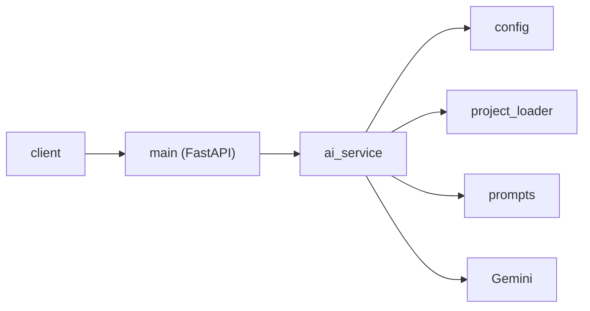

# Embedded AI Copilot

This is an AI assistant for understanding embedded C/C++ codebases. You send a question to a small FastAPI app. The app reads one project directory, `sample_project/` by default, configurable via `PROJECT_PATH`. It puts those source files into one prompt, and asks Gemini for an answer.

## Status

Phase 1.5 complete.

## Request path



## Modules

- `app/main.py` is the HTTP layer. It serves `GET /` and `POST /ask`, checks the question, and maps service errors to status codes. It does not read the project or call Gemini.
- `app/ai_service.py` orchestrates one answer: load files, build the prompt, call Gemini, and raise `ProjectLoadError`, `UpstreamRejectedError`, `EmptyUpstreamResponseError` (subclass of `UpstreamRejectedError`, maps to 502), or `UpstreamUnavailableError`. It does not define routes or scan the disk itself.
- `app/project_loader.py` reads the filesystem and applies the selection rules (extensions, hidden and build directories, directory-name excludes, and the size cap). It does not build prompts or call Gemini.
- `app/prompts.py` builds the prompt from `app/prompts/assistant.md`, the file text, and the question. It does not load the tree or call Gemini.
- `app/config.py` loads `.env` and checks `GEMINI_API_KEY`, `GEMINI_MODEL`, `EXCLUDE_DIRS`, and that the project directory exists and is a directory. It returns a frozen `Settings` dataclass. It does not call Gemini.
- `app/models.py` holds the `ProjectFile` dataclass. The HTTP body is `AskRequest` in `main.py`.
- `app/logging_config.py` sets up logging. It does not choose the log messages.

## Setup

Python 3.14 (>=3.14,<3.15). From the repo root:

```bash
uv python install 3.14
uv python pin 3.14
uv sync
```

Pin CPython 3.14. A newer interpreter can fail to build the locked `pydantic-core`.

Create `.env` in the repo root, or export the same variables:

```
GEMINI_API_KEY=your-key
GEMINI_MODEL=your-model
# Optional: directory to analyze (default: sample_project/)
# PROJECT_PATH=/absolute/path/to/your/embedded/repo
# Optional: comma-separated directory-name patterns to skip; replaces the vendor defaults.
# Use "," to include all vendor code. Hidden and build dirs are always skipped.
# EXCLUDE_DIRS=CMSIS,*_HAL_Driver,Middlewares,third_party,vendor,external,GenData
```

Startup fails if either value is missing or empty (`RuntimeError: GEMINI_API_KEY is not set.` or `RuntimeError: GEMINI_MODEL is not set.`).

The running app reads one project directory. `PROJECT_PATH` unset, empty, or whitespace-only uses `sample_project/`. A relative path resolves against the repo root, not the process cwd. A leading `~` is expanded. An absolute path is recommended. The path must be an existing directory or startup fails. The path is read once at startup; restart the app after changing it. One project is used per process. It loads `.c`, `.h`, `.cpp`, `.hpp`, `.cc`, `.cxx`, `.hh`, `.hxx`, `.inl`, `.s`, `.asm`, and `.ld` files, including files in subdirectories. Suffixes are matched case-insensitively, so `.S` and `.s` assembly and `.ld` linker scripts load.

What gets loaded: hidden directories and `build`, `out`, and `cmake-build-*` are always skipped. The vendor defaults are skipped by name, at any depth, case-insensitive. Files over 512 KiB are skipped with a warning. A non-UTF-8 file is skipped with a warning (`Skipping non-UTF-8 file: ...`).

## Run

From the repo root:

```bash
uv run uvicorn app.main:app --host 127.0.0.1 --port 8000
```

Logs go to `logs/app.log` and to the console. The `logs/` directory is created when the app starts.

## API

`GET /`

```bash
curl http://127.0.0.1:8000/
```

```json
{"message":"Embedded AI Copilot is running"}
```

`POST /ask`

```bash
curl -X POST http://127.0.0.1:8000/ask \
  -H "Content-Type: application/json" \
  -d '{"question":"Where is the answer initialized?"}'
```

Request body: `{"question":"<non-empty string>"}`.

Response body: `{"answer":"<text>"}`.

## Errors

| Status | When | Body |
| --- | --- | --- |
| 200 | Gemini returned text | `{"answer":"<text>"}` |
| 422 | Invalid, empty, or whitespace-only `question` | validation `detail` list, example below |
| 500 | Project files could not be loaded | `{"detail":"Project files could not be loaded."}` |
| 500 | Unexpected error | `Internal Server Error` |
| 502 | Gemini rejected the request, or returned empty text | `{"detail":"AI provider rejected the request."}` |
| 503 | Gemini is unavailable | `{"detail":"AI provider is unavailable."}` |

Empty question:

```bash
curl -X POST http://127.0.0.1:8000/ask \
  -H "Content-Type: application/json" \
  -d '{"question":""}'
```

```json
{"detail":[{"type":"string_too_short","loc":["body","question"],"msg":"String should have at least 1 character","input":"","ctx":{"min_length":1}}]}
```

A missing `question` or a non-string `question` also returns 422, with a different `detail` list. An unexpected exception returns the plain text `Internal Server Error`.

## Tests

```bash
uv run pytest
```

The tests run offline. Gemini is mocked.

## Design

Each module has one job. Domain data is a dataclass (`ProjectFile`, `Settings`). Pydantic validates the HTTP request (`AskRequest`). The loader, the prompt builder, and the Gemini client are called directly.

There is no RAG, agents, vector database, LangChain, or tree-sitter. The sample project is sent in one prompt. Those tools get added when this design hits a real limit.

## Roadmap

1. Phase 1: simple assistant (done)
2. Phase 1.5: engineering quality (done)
3. Phase 2: smarter project loading
4. Phase 3: tree-sitter / code structure
5. Phase 4: RAG / embeddings / ChromaDB
6. Phase 5: agentic AI

## Layout

```
.
├── app/
│   ├── __init__.py
│   ├── ai_service.py
│   ├── config.py
│   ├── logging_config.py
│   ├── main.py
│   ├── models.py
│   ├── project_loader.py
│   ├── prompts.py
│   └── prompts/
│       └── assistant.md
├── sample_project/
│   ├── inc/
│   │   ├── app.h
│   │   ├── can.h
│   │   └── gpio.h
│   └── src/
│       ├── app.c
│       ├── can.c
│       ├── gpio.c
│       └── main.c
├── tests/
│   ├── conftest.py
│   ├── test_ai_service.py
│   ├── test_api.py
│   ├── test_config.py
│   ├── test_project_loader.py
│   └── test_prompts.py
├── .gitignore
├── pyproject.toml
├── README.md
└── uv.lock
```
