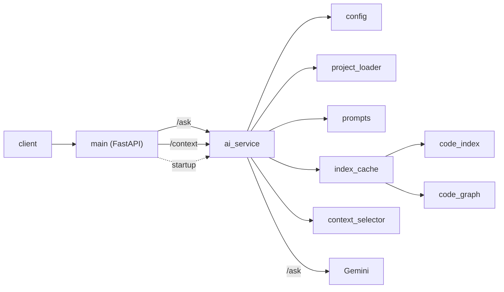

# Embedded AI Copilot

This is an AI assistant for understanding embedded C/C++ codebases. You send a question to a small FastAPI app. The app reads one project directory, `sample_project/` by default, configurable via `PROJECT_PATH`. It puts those source files into one prompt, and asks Gemini for an answer.

## Status

Phase 3 complete.

## Request path



## Modules

- `app/main.py` is the HTTP layer. It serves `GET /`, `POST /ask`, and `POST /context`, checks the question, and maps service errors to the same status codes for both POST endpoints. A lifespan thread warms the index at startup. It does not read the project or call Gemini.
- `app/ai_service.py` prepares one prompt on a path shared by `generate_answer` and `dry_run`: load files, get the index and graph from the cache, then route. Projects that fit use the full project map and count tokens (retrying once without the map if the map pushed the prompt over budget). Projects that do not fit use partial mode: a focused map, whole files selected for the question, and a partial-context notice. `generate_answer` sends that prompt to Gemini and, in partial mode, adds a footer to the answer. `dry_run` returns the same prompt and does not call Gemini. It estimates tokens from the character length unless `exact` is set, in which case it uses the same token count as `/ask`. It raises `ProjectLoadError`, `ProjectTooLargeError` (413, only when no selected file fits), `UpstreamRejectedError`, `EmptyUpstreamResponseError` (subclass of `UpstreamRejectedError`, maps to 502), or `UpstreamUnavailableError`. It does not define routes or scan the disk itself.
- `app/context_selector.py` ranks files for a question from names in it and the index/graph, and packs whole files into a char budget. `rank_files_detailed` returns the same order as `rank_files`, plus a reason. It does not read the disk or call Gemini.
- `app/index_cache.py` keeps the last project's index and graph in memory. A file is re-parsed only when its path or content (SHA-256) changes, and the graph is rebuilt only when any file changed. It does not read the disk or call Gemini.
- `app/project_loader.py` reads the filesystem and applies the selection rules (extensions, hidden and build directories, directory-name excludes, and the size cap). It returns files sorted, with paths relative to the project root. It does not build prompts or call Gemini.
- `app/prompts.py` builds the prompt from `app/prompts/assistant.md`, the file text, and the question. Full mode adds a project map (capped at 20% of the budget, compacted in fixed tiers) before the files and a file/line count header. Partial mode adds a focused map and a partial-context notice, then the selected files in rank order. It does not load the tree or call Gemini.
- `app/config.py` loads `.env` and checks `GEMINI_API_KEY`, `GEMINI_MODEL`, `EXCLUDE_DIRS`, `MAX_PROMPT_TOKENS`, and that the project directory exists and is a directory. It returns a frozen `Settings` dataclass. It does not call Gemini.
- `app/models.py` holds the `ProjectFile` dataclass, the index dataclasses (`SymbolKind`, `Symbol`, `Include`, `Call`, `FileSymbols`, `ProjectIndex`, `SymbolRef`, `CallRef`, `ResolvedInclude`, `ProjectMap`), `RankedFile`, `PreparedPrompt`, and `Answer` / `AnswerContext`. The HTTP body is `AskRequest` in `main.py`.
- `app/code_index.py` parses each loaded C/C++ file with tree-sitter and records its functions, prototypes, macros, types, file-scope variables and includes with line numbers and the names each function calls (C++: classes, namespaces, qualified names). Headers use the C++ grammar. Parse errors are tolerated. It is used by `/ask` for the project map. It does not read the disk or call Gemini.
- `app/code_graph.py` builds name-based relations from the index (who calls what, #include resolution with the nearest match first, .c/.h pairs). Ambiguous matches are kept as several candidates. Used by /ask for the project map. It does not read the disk or call Gemini.
- `app/logging_config.py` sets up logging. It does not choose the log messages.

## Setup

Python 3.14 (>=3.14,<3.15). From the repo root:

```bash
uv python install 3.14
uv python pin 3.14
uv sync
```

Pin CPython 3.14. A newer interpreter can fail to build the locked `pydantic-core`.

Create `.env` in the repo root, or export the same variables:

```
GEMINI_API_KEY=your-key
GEMINI_MODEL=your-model
# Optional: directory to analyze (default: sample_project/)
# PROJECT_PATH=/absolute/path/to/your/embedded/repo
# Optional: comma-separated directory-name patterns to skip; replaces the vendor defaults.
# Use "," to include all vendor code. Hidden and build dirs are always skipped.
# EXCLUDE_DIRS=CMSIS,*_HAL_Driver,Middlewares,third_party,vendor,external,GenData
# Optional: max prompt size in tokens (default 200000; Gemini 3.1 Pro input pricing doubles above 200k).
# MAX_PROMPT_TOKENS=200000
```

Startup fails if either value is missing or empty (`RuntimeError: GEMINI_API_KEY is not set.` or `RuntimeError: GEMINI_MODEL is not set.`).

The running app reads one project directory. `PROJECT_PATH` unset, empty, or whitespace-only uses `sample_project/`. A relative path resolves against the repo root, not the process cwd. A leading `~` is expanded. An absolute path is recommended. The path must be an existing directory or startup fails. The path is read once at startup; restart the app after changing it. One project is used per process. It loads `.c`, `.h`, `.cpp`, `.hpp`, `.cc`, `.cxx`, `.hh`, `.hxx`, `.inl`, `.s`, `.asm`, and `.ld` files, including files in subdirectories. Suffixes are matched case-insensitively, so `.S` and `.s` assembly and `.ld` linker scripts load.

What gets loaded: hidden directories and `build`, `out`, and `cmake-build-*` are always skipped. The vendor defaults are skipped by name, at any depth, case-insensitive. Files over 512 KiB are skipped with a warning. A file that isn't valid UTF-8 is read as Windows-1252 (cp1252) with a warning; if neither works it's skipped with a warning.

Prompt order in full mode: instructions, project map, file/line count header, files sorted by path (relative paths, per-file line counts), question. The map lists per file its includes, types, macros, variables, declared and defined functions (with line ranges) and statics. It's capped at 20% of MAX_PROMPT_TOKENS (about 3 characters per token) and compacted in fixed tiers (no macros, then no statics, then counts only, then omitted). Its first line names the tier. Headers included but not loaded are listed as external. Partial mode uses the same instructions, then a focused map, a partial-context notice, the selected files in rank order, and the question.

## Prompt budget

Each answer calls Gemini's free `count_tokens` before `generate_content`. Routing uses the total source characters. At most 10 characters per allowed token, the request stays in full mode: the project map, every file, and one count. If that count is over the limit, the map is dropped and the tokens are counted again. If both full counts are over, or the source is already over the character limit, the request uses partial context instead of returning 413. The character limit does not skip the index: the cache is read on every request, and a background thread warms it at startup.

Partial context ranks files from names in the question and the index and graph, then packs whole files into the remaining character budget. The prompt includes a partial-context notice. The answer text ends with a fixed footer listing the included files. One exact count follows. If it is still over, the lowest-ranked included files are dropped once and the prompt is counted again. 413 is returned only when not even one selected file fits (an estimated count, with no `count_tokens` call) or when the partial prompt is still over the limit after that shrink. A request counts tokens at most four times. A `MAX_PROMPT_TOKENS` value above about 1M gets a 502 from Gemini. The index and graph stay cached between requests and refresh from the loaded files, so code edits are picked up without a restart.

## Run

From the repo root:

```bash
uv run uvicorn app.main:app --host 127.0.0.1 --port 8000
```

Logs go to `logs/app.log` and to the console, including the startup configuration messages. The `logs/` directory is created when the app starts.

## API

`GET /`

```bash
curl http://127.0.0.1:8000/
```

```json
{"message":"Embedded AI Copilot is running"}
```

`POST /ask`

```bash
curl -X POST http://127.0.0.1:8000/ask \
  -H "Content-Type: application/json" \
  -d '{"question":"Where is the answer initialized?"}'
```

Request body: `{"question":"<non-empty string>"}`.

Response body: `{"answer":"<text>","context":{...}}`. `answer` is the model text. In partial mode that text also ends with the partial-context footer.

`context` describes what was sent:

```json
{
  "mode": "partial",
  "files_total": 16595,
  "files_included": [
    "Projects/STM32F4-Discovery/Examples/GPIO/GPIO_EXTI/Src/stm32f4xx_it.c"
  ],
  "prompt_tokens": 48000,
  "map_tier": "focused"
}
```

`mode` is `full` or `partial`. `files_included` lists every loaded file in full mode, and the files that were sent in partial mode. `prompt_tokens` is the exact count of the prompt that was sent. `map_tier` is the project map tier, or `null` when full mode dropped the map.

`POST /context`

Same body as `POST /ask`. It returns what `/ask` would send, and it does not call Gemini.

```bash
curl -X POST http://127.0.0.1:8000/context \
  -H "Content-Type: application/json" \
  -d '{"question":"In STM32F4-Discovery GPIO_EXTI, what does EXTI0_IRQHandler call?"}'
```

On the 38-file selection fixture, with `MAX_PROMPT_TOKENS` at 2000, that question returns:

```json
{
  "mode": "partial",
  "limit": 2000,
  "prompt_tokens": 1454,
  "token_source": "estimate",
  "prompt_chars": 4362,
  "files_total": 38,
  "files_included": [
    "Projects/STM32F4-Discovery/Examples/GPIO/GPIO_EXTI/Src/stm32f4xx_it.c",
    "Projects/STM32F4-Discovery/Examples/GPIO/GPIO_EXTI/Inc/stm32f4xx_it.h",
    "Projects/STM32F4-Discovery/Examples/GPIO/GPIO_EXTI/Inc/main.h",
    "Projects/STM32F4-Discovery/Examples/GPIO/GPIO_EXTI/EWARM/startup_stm32f407xx.s"
  ],
  "map_tier": "focused",
  "map_files": 7,
  "ranked_total": 38,
  "ranked": [
    {
      "path": "Projects/STM32F4-Discovery/Examples/GPIO/GPIO_EXTI/Src/stm32f4xx_it.c",
      "reason": "defines",
      "included": true,
      "focus": 2,
      "tier": 1,
      "hits": 1,
      "lexical": 6
    }
  ]
}
```

`ranked` in that example is only the first of 38. The response lists up to 50, and `ranked_total` is the full count. Full mode returns `ranked_total` 0 and `ranked` `[]`. `included` says whether that ranked file is in the prompt. `files_included` is every loaded file in full mode, and the packed files in partial mode. `map_files` is 0 when full mode drops the map.

`prompt_tokens` defaults to `ceil(len(prompt) / 3)` and `token_source` is `estimate`. That estimate is conservative. Near the limit it can choose partial mode where `/ask` would still fit in full mode. `?exact=true` counts tokens with Gemini's free `count_tokens` (this needs a key) and then matches `/ask`. 502 and 503 are only possible with `?exact=true`.

## Errors

| Status | When | Body |
| --- | --- | --- |
| 200 | Gemini returned text | `{"answer":"<text>","context":{...}}` |
| 422 | Invalid, empty, or whitespace-only `question` | validation `detail` list, example below |
| 413 | Prompt exceeds the token budget, only when even one selected file does not fit | `{"detail":"Project is too large for the prompt budget: <n> tokens, limit <limit>. Point PROJECT_PATH at a smaller directory or raise MAX_PROMPT_TOKENS."}` |
| 500 | Project files could not be loaded | `{"detail":"Project files could not be loaded."}` |
| 500 | Unexpected error | `Internal Server Error` |
| 502 | Gemini rejected the request, or returned empty text, or returned no token count | `{"detail":"AI provider rejected the request."}` |
| 503 | Gemini is unavailable | `{"detail":"AI provider is unavailable."}` |

Empty question:

```bash
curl -X POST http://127.0.0.1:8000/ask \
  -H "Content-Type: application/json" \
  -d '{"question":""}'
```

```json
{"detail":[{"type":"string_too_short","loc":["body","question"],"msg":"String should have at least 1 character","input":"","ctx":{"min_length":1}}]}
```

A missing `question` or a non-string `question` also returns 422, with a different `detail` list. An unexpected exception returns the plain text `Internal Server Error`.

`POST /context` uses these same status codes and the same `detail` text. 502 and 503 happen only with `?exact=true`.

## Tests

```bash
uv run pytest
```

The tests run offline. Gemini is mocked.

## Selection eval

`tests/test_selection_eval.py` ranks 10 questions against a 38-file fixture: two boards, three examples, and the BSP. Each case checks that every expected file is inside its own pinned top-k. There is no aggregate score.

Two cases are pinned at k=4, where today's ranking misses a tighter cutoff:

- E7, "Which function handles the ADC interrupt in ADC_RegularConversion on STM32F429I-Discovery?": there is no synonym from "interrupt" to `IRQ`, so the handler is rank 4.
- E10, "Who calls BSP_LED_Toggle?": the definition ranks before the callers, so the call sites are ranks 3 and 4.

```bash
uv run pytest tests/test_selection_eval.py
uv run python scripts/eval_selection.py <cube_root>
```

`scripts/eval_selection.py` loads a Cube tree with the default directory excludes, builds the index and graph, and ranks the cases in `scripts/cube_eval_cases.json`. It does not call Gemini. A failing case still exits 0.

## Design

Each module has one job. Domain data is a dataclass (`ProjectFile`, `Settings`). Pydantic validates the HTTP request (`AskRequest`). The loader, the prompt builder, and the Gemini client are called directly.

There is no RAG, agents, vector database, or LangChain. Phase 3 adds a tree-sitter code index used for the project map. When the project does not fit the prompt budget, files are selected from names in the question and the index and graph, without embeddings, and sent whole. The sample project is sent in one prompt. Those tools get added when this design hits a real limit.

## Phase 3 summary

Phase 3 goes from a tree-sitter index, to a code graph, to a project map in the prompt, to an in-memory cache, to partial context when the project does not fit, to a dry run at `POST /context`.

On STM32CubeF4 (~16.6k files): warm-up ~15 s, ~1-2 s per partial question with a stub client, RSS ~450-650 MB.

## Roadmap

1. Phase 1: simple assistant (done)
2. Phase 1.5: engineering quality (done)
3. Phase 2: smarter project loading (done)
4. Phase 3: tree-sitter / code structure (done)
5. Phase 4: RAG / embeddings / ChromaDB
6. Phase 5: agentic AI

## Layout

```
.
├── app/
│   ├── __init__.py
│   ├── ai_service.py
│   ├── code_graph.py
│   ├── code_index.py
│   ├── config.py
│   ├── context_selector.py
│   ├── index_cache.py
│   ├── logging_config.py
│   ├── main.py
│   ├── models.py
│   ├── project_loader.py
│   ├── prompts.py
│   └── prompts/
│       └── assistant.md
├── scripts/
│   ├── cube_eval_cases.json
│   └── eval_selection.py
├── sample_project/
│   ├── inc/
│   │   ├── app.h
│   │   ├── can.h
│   │   └── gpio.h
│   └── src/
│       ├── app.c
│       ├── can.c
│       ├── gpio.c
│       └── main.c
├── tests/
│   ├── conftest.py
│   ├── test_ai_service.py
│   ├── test_api.py
│   ├── test_code_graph.py
│   ├── test_code_index.py
│   ├── test_config.py
│   ├── test_context_selector.py
│   ├── test_index_cache.py
│   ├── test_logging_startup.py
│   ├── test_project_loader.py
│   ├── test_prompts.py
│   └── test_selection_eval.py
├── .gitignore
├── pyproject.toml
├── README.md
└── uv.lock
```
